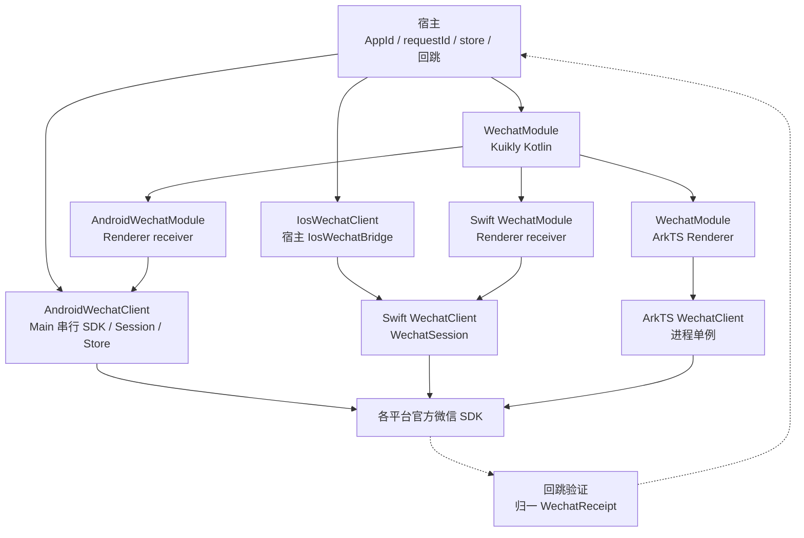
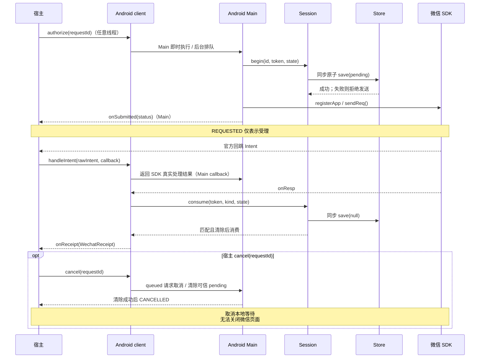
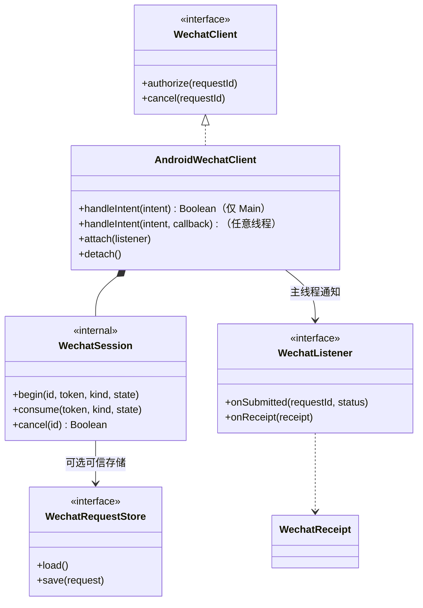

# GY CrossKit Wechat

> 当前源码准备 Maven（core/Kuikly）`1.1.0`、iOS Git Pod/SPM `native-1.1.0` 与 HAR `har-1.1.0`。发布与精确公开消费尚待完成；下方历史安装示例及验收保留原标签范围，不代表新候选已可消费。Kuikly 基线保持 2.29.1。

当前分支包含未发布的按类型当前轮及通用接线下沉修复：登录、分享、转账互不等待；同类型新请求替换旧轮，并通知本地取消，不伪造 SDK 回执。图片与网页共用分享轮次；通用回执投影、平台归属能力、Base64 直通和 OHOS 监听恢复由组件统一提供。iOS 无 transaction 的候选限制保留。安装示例、已发布版本与历史验收不包含本任务改动，宿主远程版本和正式提审依赖未升级。合同见[按类型当前轮](docs/功能与平台差异.md#按类型当前轮合同未发布)。

历史修复组合：Maven `0.1.10-rc.1`、HAR `0.1.9-rc.1`，Git Pod / SPM 保留 `native-0.1.9`（Pod `0.1.9`）。Android/OHOS 转账受理后不再等待最终回执才能重试，OHOS 使用实际调用方 Ability context。发布与远程消费状态分别见 [Maven Release](https://github.com/gycrosskit/wechat/releases/tag/0.1.10-rc.1) 和 [HAR Release](https://github.com/gycrosskit/wechat/releases/tag/har-0.1.9-rc.1)；发布候选声明不能替代渠道可消费及设备验收。

2026-10-09 已发布：Maven `0.1.8`、Git Pod `native-0.1.7`（内部 `0.1.7`），HAR 不变。新增 Android/iOS Kuikly Native Module receiver 与平台变体；已发布 Maven `0.1.7` 不包含此能力。iOS receiver 从可选 `GycWechatNative/Kuikly` Git Pod subspec 导出，默认 Native Pod / Wechat SPM 不自动依赖 Kuikly。具体发布与远程验收结果见[对应 Release](https://github.com/gycrosskit/wechat/releases/tag/0.1.8)。接线见[接入指南的 Native receiver](docs/接入指南.md#androidios-kuikly-native-receiver)。

2026-10-10 已发布原生修复：[Swift Package / Git Pod `native-0.1.8`](https://github.com/gycrosskit/wechat/releases/tag/native-0.1.8)（Pod内部 `0.1.8`），修复 journal 清除失败后同一 OAuth URL 无法重试。仅原生源码改变，继续搭配 Maven `0.1.8` 与 HAR `0.1.6`；入口回归、官方 SDK 编译和独立远程 Git Pod / SPM 消费均通过，[Release 消费门禁](https://github.com/gycrosskit/wechat/actions/runs/38015413617)已成功，设备业务待验收。

## 当前功能与平台边界

core 与原生client提供OAuth、图片/网页分享和商家转账确认页；不提供业务页面 UI，wechat-kuikly源码提供Android/iOS/OHOS发送端及原生receiver。iOS2.0.7支持指定联系人图片分享，OHOS1.0.23不支持。

2026-10-08 历史基线：Maven 0.1.7；Swift Package / Git Pod native-0.1.6（Pod内部0.1.6）；HAR 0.1.6。该基线修复与平台边界见[功能与平台差异](docs/功能与平台差异.md)，构建与渠道验收见[版本发布记录](https://github.com/gycrosskit/wechat/releases/tag/0.1.7)；下方旧版本记录保留其历史范围。

当前测试覆盖、执行时点和未验收项集中见[验证范围](docs/功能与平台差异.md#验证范围)，复现命令见[开发与验证](docs/开发与验证.md)。

微信 SDK 的 OAuth 授权、图片/网页分享和商家转账确认页入口，提供请求受理状态与 SDK 回执。账号换票、分享任务、订单查询及凭据由宿主负责；转账页面 `success` 不表示资金到账。

旧版本验收见 [native-0.1.4](docs/native-0.1.4发布验收.md)、[Maven 0.1.5](docs/0.1.5远程发布验收.md)与 [0.1.4](docs/0.1.4远程发布验收.md)；指定联系人合同见[接入指南](docs/接入指南.md#ios-原生与-kmp-接入)。

## 架构与调用流程

Kuikly 三端统一通过 WechatModule 接入各端 receiver，并复用宿主已有唯一原生 client；原生非 Kuikly 消费者仍可直接用 core/client。宿主在隐私准入后转发官方 SDK 回跳；请求受理与业务回执分开。可信 pending 存储由宿主提供，不能从外部回跳重建授权资格。



下面是 Android OAuth 的关键流程；Android/OHOS 回执校验 transaction、kind 和 OAuth state。iOS OAuth 以 state 关联，分享没有 SDK transaction，只有本地单笔候选，不能沿用图中的 Android 归属证明。



类型图聚焦 Kotlin Android 链路，`WechatSession` 按类型持有当前轮；监听器分别接收受理、本地取消与 SDK 回执。图片仅等待 SDK 受理；iOS 图片受理或收到图片回执、或已发送网页取消后不再提供分享候选，后续分享仍可提交。Kuikly `dispose()` 移除页面监听和 callback，原生 client 仍为进程级实例；取消是否成功必须等待同版原生确认。



源码入口：[公共契约与回执](wechat-core/src/commonMain/kotlin/io/github/gycrosskit/wechat/WechatClient.kt)、[Android SDK 接线](wechat-core/src/androidMain/kotlin/io/github/gycrosskit/wechat/AndroidWechatClient.kt)、[Kotlin pending](wechat-core/src/commonMain/kotlin/io/github/gycrosskit/wechat/WechatSession.kt)、[iOS KMP 桥](wechat-core/src/iosMain/kotlin/io/github/gycrosskit/wechat/IosWechatClient.kt)、[Swift client](iosApp/Sources/GycWechatNative/WechatClient.swift)、[Swift 分享隔离](iosApp/Sources/GycWechatNative/WechatSession.swift)、[Kuikly 取消确认与 dispose](wechat-kuikly/src/commonMain/kotlin/io/github/gycrosskit/wechat/kuikly/WechatModule.kt)、[OHOS client](ohos/wechat-native/src/main/ets/WechatClient.ets)。指定联系人图片分享已在 Android 和当前 iOS 源码实现，OHOS 官方 SDK 1.0.23 未公开接收者字段，仍返回不支持；转账页回执不是到账证明。

## 支持范围

| 入口 | 平台要求 | 厂商依赖 |
| --- | --- | --- |
| `wechat-core` | Android API 24；iOS 15；OHOS KMP 桥 | Android 微信 SDK 6.8.34；iOS 使用原生桥 |
| `GycWechatNative` | iOS 15，Swift / Git Pod | WechatOpenSDK-XCFramework 2.0.7 |
| `@gycrosskit/wechat-native` | HarmonyOS API 22 | @tencent/wechat_open_sdk 1.0.23 |
| `wechat-kuikly` | 0.1.8含Android/iOS/OHOS Kuikly Module；已发布0.1.7仅OHOS | 当前未发布候选：Kuikly 2.29.1；旧版锁 2.28.0 |

KMP 使用 Kotlin **2.2.21-1.0.0** OHOS 工具链。KMP 产物和 HAR 是独立渠道；KMP 依赖不能代替原生 SDK 注册、回跳与签名配置。

## 安装

Gradle 仓库与依赖：

```kotlin
// settings.gradle.kts：保留已有 google() / mavenCentral()
dependencyResolutionManagement {
    repositories {
        google()
        mavenCentral()
        maven("https://jitpack.io") { content { includeGroup("com.github.gycrosskit.wechat") } }
        maven("https://maven.eazytec-cloud.com/nexus/repository/maven-public/")
        maven("https://mirrors.tencent.com/nexus/repository/maven-public/")
        exclusiveContent {
            forRepository {
                maven { url = uri("https://mirrors.tencent.com/nexus/repository/maven-tencent/") }
            }
            filter { includeGroup("com.tencent.kuikly-open") }
        }
    }
}
// commonMain.dependencies
implementation("com.github.gycrosskit.wechat:wechat-core:1.0.1")
// Android/iOS/OHOS Kuikly 宿主额外添加：
implementation("com.github.gycrosskit.wechat:wechat-kuikly:1.0.1")
```

iOS 选择 Git Pod，或 Xcode 的 Swift Package：

```ruby
pod 'GycWechatNative', :git => 'https://github.com/gycrosskit/wechat.git', :tag => 'native-1.0.1'
```

Swift Package URL 为 `https://github.com/gycrosskit/wechat.git`，固定 revision/tag 为 `native-1.0.1`，产品 `GycWechatNative`。Package 不包含微信 binaryTarget，宿主仍需提供并链接官方 XCFramework；Git Pod 会安装精确版本厂商依赖，Git Pod 不通过 CocoaPods Specs 分发。Native SPM 与 Pod 二选一；使用 `/Kuikly` subspec 时由其包含 Native，不再额外打包同名 SPM 产品。

HarmonyOS 本版 HAR 为 `0.1.9-rc.1`，配套 Maven `0.1.10-rc.1` / Git Pod `native-0.1.9`。按精确 [HAR Release](https://github.com/gycrosskit/wechat/releases/tag/har-0.1.9-rc.1) 的 `WechatNative.har` 和 `har-release-checksums.txt` 冻结 SHA-256 校验后，可验证 Release HAR 消费；OHPM 审核及 Registry 安装/编译分别核实，不覆盖旧标签或归档。

```sh
# 仅 Registry 精确版本可查询、可安装后使用；审核受理不等于上架。
ohpm install @gycrosskit/wechat-native@1.0.1
```

受控发布由原发布器按版本确定 dist-tag：正式版使用默认 `latest`，预发布使用 `candidate-<完整版本>`；不手工固定 `next`，未知结果沿原 journal 查回。公开 Release HAR 消费与 Registry 安装分别验收，操作入口见[开发与验证](docs/开发与验证.md#har-rc-冻结与公开消费)。

## 最小接入

Android 在隐私准入后构造并持有一个进程级客户端；构造及 Unit 入口允许后台调用，SDK 与 store 在 Main 懒初始化：

```kotlin
import io.github.gycrosskit.wechat.AndroidWechatClient
import io.github.gycrosskit.wechat.WechatScene

val client = AndroidWechatClient(application, appId, listener, trustedStore)
client.authorize(uniqueRequestId) // 返回不保证已发送；等待 Main onSubmitted(REQUESTED)。
// 普通好友分享；requestId 每次调用唯一，不复用。
client.shareImage(anotherUniqueRequestId, imageBytes, WechatScene.SESSION)
```

上述类型来自 `wechat-core`，完整包名、监听器、store 与平台示例见[接入指南](docs/接入指南.md)。宿主必须实现 `{applicationId}.wxapi.WXEntryActivity`，在 Main `onCreate/onNewIntent` 把原始 Intent 交给同一实例的同步 `handleIntent(intent): Boolean` 并结束 Activity；后台接入使用 `handleIntent(intent) { handled -> ... }`，callback 在 Main 返回 `Result<Boolean>`，成功值为真实 SDK Boolean，失败为异常；授权字段只能由官方 SDK 验证。还需配置 INTERNET、开放平台包名和签名。

iOS 持有唯一 `WechatClient`，在途相同 URL 去重；OAuth 在可信 journal 成功清除后确认摘要，清除失败保留 pending 并允许同 URL 再交 SDK 验证。把 URL Scheme / Universal Link 交给 `handleOpenURL` / `handleUniversalLink`；宿主配置 Info.plist、Associated Domains 与 AASA。KMP 使用导出的 `IosWechatBridge`，参考 [Swift 适配示例](iosApp/KmpWechatBridge.swift)。

OHOS 在 EntryAbility 配置 `WechatClient.configure(appId, context, trustedStore)` 并交回跳 Want；初始化前可调用 `forwardWant`。多 Ability 宿主在每次用户操作前，用实际发起操作的 UIAbilityContext 再调用 `configure`；同一 AppID 复用唯一 SDK，请求开始后固定持有该 context，异步图片处理不受后续配置切换影响。Kuikly 两端注册 `GycWechat` Module，页面释放时调用 `dispose()`，原生监听对应移除。

## 必须了解的边界

- 转账与登录、分享各保留当前轮；再次转账替换旧轮本地等待，不等待上一笔 SDK 回执。Android/OHOS 按当前 transaction/requestId 匹配，iOS 仍为提交结束即释放、回执 UNATTRIBUTED；转账页 success 不表示到账。新转账不写 journal，也不会覆盖 OAuth journal。

- Android 构造、授权、分享、转账、取消与 attach/detach 允许任意线程；主线程即时执行，后台排队，图片计算仍在专用 imageExecutor。Unit 返回不代表 SDK 受理；同步 Boolean `handleIntent` 仍限定 Main，兼容旧 false 表示未处理（含 SDK 异常），后台必须使用 callback 重载，不阻塞等待。
- Android Main 取消尚未执行的入队请求后，该请求不会打开微信。`cancel` 返回不保证清除；存储清除失败保留 pending/owner，不伪造 CANCELLED 或 FAILED 终态，未知 ID 不通知终态。无 owner 的回执支持晚监听；有 owner 的迟回执只交给同一 listener（detach 后重新 attach 也可回放），新 listener 不接旧 owner 结果。
- `REQUESTED` 只表示 SDK 受理。Android/OHOS 按 transaction、类型和 OAuth state 验证回执；iOS 分享没有 transaction，`requestId == nil`，`SINGLE_PENDING` 只是当前单笔任务的本地候选，不能当成 SDK 准确关联或资金凭据。
- 图片只报告 SDK 提交结果，受理后释放占用，不持久恢复或交付业务回执。网页保留任务回执关联；iOS 图片受理或已收到图片回执、或已发送网页取消后，`canCorrelateShareReceipt` 永久为 false，分享回执为 `UNATTRIBUTED`，后续网页也只等受理。宿主此时清理任务关联，不能把旧回执用于新任务，也不能重建 client 绕过归属边界。
- 冷启动恢复需要宿主提供同步原子可信 store，发送前保存、消费/取消前清除。不能从 Intent/Want/URL 生成恢复记录；iOS 只恢复 OAuth。归一回执的迟监听缓存仅限当前进程，业务服务端仍需兜底。
- 图片最大 25 MiB，缩略图最大 32 KiB；Android 大于 10 MiB 需满足专用客户端版本门槛。指定联系人由 Android 和当前 iOS 源码支持，需同 App 可信接收者和发送者 openId；Android 保留 SDK 客户端版本门槛，iOS 使用官方场景及收件人字段并等待真实 SDK 受理/回执。OHOS 仍不支持，不降级普通好友；iOS 最低客户端条件及真实发送待设备验收。
- 凭据、state、Code、原始回跳与商户参数不得写入日志。`cancel` 只能结束本地等待；库不实现普通 `PayReq` APP 支付。

各平台的存储失败、取消、图片资源及重复回执处理详见接入指南。实际微信客户端、签名回跳、Universal Link 与转账兼容性需要设备验收，编译通过不代表业务成功。

## 文档与反馈

- [接入指南](docs/接入指南.md)：平台接线、回执归属、冷启动恢复与分享契约。
- [开发与验证](docs/开发与验证.md) · [验证记录](VALIDATION.md)。
- [Releases](https://github.com/gycrosskit/wechat/releases) · [Issues](https://github.com/gycrosskit/wechat/issues)：附版本、平台和脱敏复现步骤。

由 GY CrossKit 维护，采用 [Apache-2.0](LICENSE)；厂商 SDK 适用其自身许可与隐私政策。

## OHOS pending 存储（0.1.3）

组件提供 `WechatPreferencesRequestStore(appId, context, namespace)`，默认 namespace 为 `wechat_pending_${appId}`，兼容旧宿主 `pending` 字段。

```typescript
const store = new WechatPreferencesRequestStore(appId, context);
const restored = store.load(); // 业务恢复资格由宿主判断
const client = WechatClient.configure(appId, context, store);
```

同步 flush 失败抛异常，SDK发送前不能吞掉；不会从外部 Want 构造可信记录。`configure` 未显式提供 store 时仍维持原进程内语义。
Node替身检查覆盖旧namespace、重启/隔离、删除与落盘失败；不代表真实设备磁盘或微信已验收。

## 自动回归

当前源码回归使用[统一远程验证（Jenkins）](https://github.com/gycrosskit/.github/blob/main/docs/统一远程验证.md)，按已推送源码 ref/SHA 选择对应组件；平台命令与参数以受信 Jenkins recipe 为准。实际执行范围、测试数量、结果与耗时以绑定源码/CI SHA 的构建回执为准，轻量检查或跳过不算平台测试通过。

候选冻结与消费按[发布流程](https://github.com/gycrosskit/.github/blob/main/docs/发布流程.md)使用独立 Job：`component-ci/package` 绑定准确 SOURCE_SHA 生成冻结候选并验证私有消费，`component-ci/release` 绑定准确 Tag/候选执行发布及独立公开消费。核对冻结归档、精确 tag/commit、完整 publication 清单和公开文件，不使用 `mavenLocal`、本库源码或 staging 替换公开依赖；各阶段证据分别记录。

HAR 构建与精确公开 HAR 消费使用已有 `gycrosskit-wechat-har` Jenkins job 和受控 HarmonyOS CLT，不能由 Maven job 的成功代算。OHPM Registry 安装与真机业务仍分别验收。

阶段、缓存、有限网络重试、失败记录与证据边界见[共用 CI 规则](https://github.com/gycrosskit/.github/blob/main/docs/持续集成门禁.md)；本库实际平台命令以 Jenkins 的固定版本 recipe 为准。源码通过、远程消费、HAR/ohpm 与设备验收分别记录。

公网核验同步组织 `templates/check-public-maven.py`：使用冻结归档给出的完整 publications 清单，核对 JitPack tag/commit、每个公开 POM/Module、全部声明变体字节大小和四类哈希、内部精确版本及 `available-at`；MD5/SHA-1 sidecar 必须匹配。SHA-256/SHA-512 sidecar 的 HTTP 404 单独输出为渠道缺失，不计为校验通过。

当前未发布源码在现有 Module 增加 `awaitSubmission`，通用超时/取消按请求隔离；REQUESTED 不等待最终回执，也不阻止下一次请求。契约见[功能与平台差异](docs/功能与平台差异.md)。
